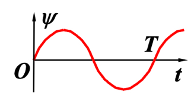
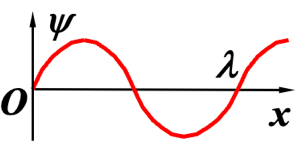

+++
date = '2026-11-02T22:43:11-08:00'
draft = false
title = '波的一些公式 Part 1'
tags = ["Homework", "知识点总结"]
categories = ["基础物理学"]
math = true
+++

# 一些特定的称谓

 \(\psi-t\) 曲线：
*   对于确定的 \(\vec{r}_0\)，\(\psi(\vec{r}_0, t)\) 表示以 **\(\vec{r}_0\)** 为平衡位置的质点的 **振动方程**
*   相应的 \(\psi-t\) 曲线称为 **振动图像**。

示例图：

\(\psi-x\) 曲线：
*   对于确定的 \(t_0\)，\(\psi(\vec{r}, t_0)\) 表示 \(t_0\) 时刻的 **波形**。
*   相应的 \(\psi-x\) 曲线称为 **波形图（或波的图像）**。

# 一些公式

## 理想气体声速

$$
u = \sqrt{\frac{\gamma}{p\rho}}
$$

其中，$\gamma$ 是气体的绝热指数，也是比热容比，$p$则是压强

## 固体中的纵波

这里一般都是用细长杆纵波公式：
$$
v = \frac{E}{\rho}
$$
其中，$E$ 是杨氏模量也是弹性模量，$\rho$是密度

## 波的表达式

$$
\boxed{\psi(x,t) = A\cos\!\left[2\pi\left(\frac{t}{T} \mp \frac{x}{\lambda}\right) + \varphi_0\right]}
$$

注意不要忘记了里面$x, t$外面的那个$2\pi$是很关键的

如果是要求某点或某时间的振动表达式，就把时间或者位移代入进去

要求解$\varphi_0$的话，则令$x, t$均为0，然后看看取值

## 波的平均能量密度

机械波中的能量密度：
$$
\bar \omega = \frac{1}{2} \rho A^2 \omega^2
$$
如果有波的强度会有个更简单的方式，对于正弦式行波声波来说：
$$
\bar \omega = \frac{I}{c}
$$
其中$I$为声强，$c$为波速

如果要求解最大能量密度的话，$\omega_{max} = 2 \bar \omega$

### 同相面间能量

这里只需要求出一个波长，然后结合面积可以算出之间的体积，再和我们的平均能量密度一起就可以求解出来了

## 声压振幅

$$
P_m = \rho u A \omega
$$

其中，$u$是为波速，$A$是为振幅，$\omega$是为角频率

### 声压振幅和波强的关系

$$
I = \frac{P_m^2}{2\rho u}
$$

$I$是波强，在声波这里也是声强

## 声强级

$$
L = 10 \log{\frac{I}{I_0}}
$$

单位是为 $dB$ ，其中 $I_0$ 是人耳1000Hz的闻阈：$I_0 = 10^{-12} W/m^2$

