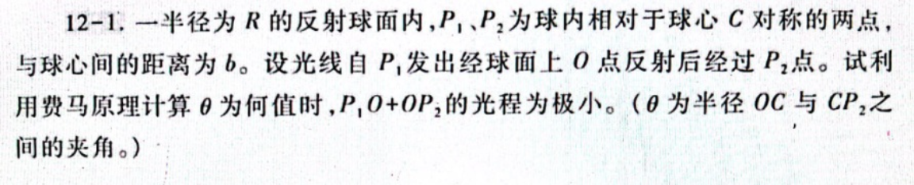

+++
date = '2026-11-19T20:57:45-05:00'
draft = false
title = '波动光学的一些公式 Part 1: 费马原理与平面波基础'
tags = ["Homework", "知识点总结"]
categories = ["基础物理学"]
math = true
+++

## 费马原理

光线在两点之间传播的实际路径，是光程取极值（极大值、极小值或恒定值）的路径。

### 常见应用

解题时通常需要求光程的极值（多为极小值）。基本思路是：选取合适的未知数将光程表示成函数；由费马原理可知光线沿光程取极值的路径传播，因此只需对光程求导并令导数为 $0$，再判断该点对应极大值还是极小值即可。

## 波长、波速与频率的关系

$$
c = \lambda_0 \nu
$$

其中，$c$ 表示真空中的光速，$\nu$ 表示光的频率，$\lambda_0$ 表示真空中的波长。

## 折射率的定义

$$
n = \frac{c}{v}
$$

其中，$n$ 表示介质的折射率，$v$ 表示光在该介质中的传播速度。

光进入介质后，由于一般介质的折射率 $n > 1$，波速会减慢；而光的频率 $\nu$ 保持不变，因此波长相应减小，满足：

$$
\lambda = \frac{\lambda_0}{n}
$$

其中，$\lambda_0$ 为光在真空中的波长，$\lambda$ 为光在介质中的波长。

## 三维平面波的波动表达式

三维空间中沿单位矢量 $\vec{n} = (\cos\alpha, \cos\beta, \cos\gamma)$ 传播的平面简谐波，其标准表达式为：

$$
U = A \cos\left[\omega t - \frac{2\pi}{\lambda}(x\cos\alpha + y\cos\beta + z\cos\gamma)\right]
$$

其中 $\alpha, \beta, \gamma$ 分别是波传播方向与 $x, y, z$ 轴正方向的夹角（即方向角）。

> 可以将原点视为振动的参考起点：沿波的传播方向，其余各点的振动在相位上均落后于原点，式中的 $-\frac{2\pi}{\lambda}(x\cos\alpha + y\cos\beta + z\cos\gamma)$ 即表示相对原点的相位滞后。