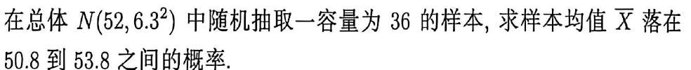
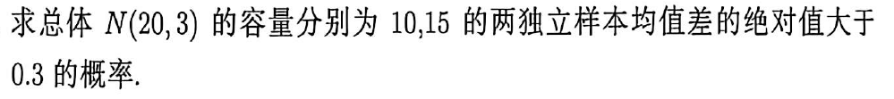
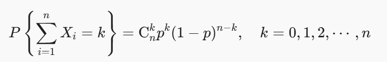

+++
date = '2026-11-21T06:09:45-05:00'
draft = false
title = '抽样分布、正态总体与常见分布速查'
tags = ["Homework", "知识点总结"]
categories = ["概率论"]
math = true
+++

本文涵盖**抽样分布通用结论**、**正态分布及其解题思路**、**分布律概念**以及**常见分布的数字特征**，方便后续复习与考前速查。

## 一、抽样分布基础

### 1. 简单随机样本的三大通用公式

对于**任意总体分布**，只要样本是来自总体的简单随机样本，以下三个公式始终成立：

$$
E(\overline{X}) = E(X)
$$

$$
D(\overline{X}) = \frac{D(X)}{n}
$$

$$
E(S^2) = D(X)
$$

其中，$n$ 为样本容量，$\overline{X}$ 为样本均值，$S^2$ 为样本方差。

### 2. 正态总体的抽样分布定理

当总体服从正态分布 $X \sim N(\mu, \sigma^2)$，从中抽取容量为 $n$ 的样本时，样本均值 $\overline{X}$ 与样本方差 $S^2$ 分别满足：

- **样本均值的分布**：

$$
\overline{X} \sim N\left(\mu, \frac{\sigma^2}{n}\right)
$$

- **样本方差的抽样分布定理**：

$$
\frac{(n-1)S^2}{\sigma^2} \sim \chi^2(n-1)
$$

## 二、正态分布与常见解题思路

### 1. 概率密度函数

若 $X \sim N(\mu, \sigma^2)$，其概率密度函数为：

$$
f(x) = \frac{1}{\sqrt{2\pi}\sigma} e^{-\frac{(x-\mu)^2}{2\sigma^2}}, \quad -\infty < x < +\infty
$$

### 2. 求样本均值的概率范围（标准化查表）

已知总体服从正态分布 $X \sim N(\mu, \sigma^2)$，则样本均值也服从正态分布 $\overline{X} \sim N\left(\mu, \frac{\sigma^2}{n}\right)$。

求样本均值落在某一范围内的概率时，将其**转化为标准正态分布**，再通过查表即可求得解答。

#### 例题

### 3. 多变量组合变换求概率

当题目所求的量涉及多个随机变量共同出现时，可以将这些变量进行**组合变换**，构造出一个新的随机变量，先求出新变量的均值和方差，再求解对应概率。

#### 例题

> [!TIP]
>
> **解题思路**：先将题目中的两个样本均值分别记为 $\overline{X}$、$\overline{Y}$，最终所求的变量形式为 $|\overline{X} - \overline{Y}|$；据此先求出组合变量的均值和方差，再代入正态分布求解概率即可。

## 三、分布律

求解分布律的核心要点是：**分布律必须对应随机变量“等于”某个具体取值的情形**，本质上就是求出随机变量等于该取值时的概率。

### 例题（二项分布）

## 四、常见分布的期望与方差速查

### 1. 卡方分布

已知总体 $X \sim \chi^2(n)$，其数学期望与方差分别为：

$$
E(X) = n, \quad D(X) = 2n
$$

### 2. 二项分布（$0\text{-}1$ 分布）

已知总体 $X \sim b(1, p)$，其数学期望与方差分别为：

$$
E(X) = p, \quad D(X) = p(1-p)
$$

---

## 核心公式速查表

| 知识点 / 分布 | 分布或统计量 | 关键结论 / 数字特征 |
| :--- | :--- | :--- |
| 简单随机样本（任意总体） | $\overline{X},\ S^2$ | $E(\overline{X}) = E(X)$，$D(\overline{X}) = \dfrac{D(X)}{n}$，$E(S^2) = D(X)$ |
| 正态总体样本均值 | $X \sim N(\mu, \sigma^2)$ | $\overline{X} \sim N\left(\mu, \dfrac{\sigma^2}{n}\right)$ |
| 正态总体样本方差 | $X \sim N(\mu, \sigma^2)$ | $\dfrac{(n-1)S^2}{\sigma^2} \sim \chi^2(n-1)$ |
| 卡方分布 | $X \sim \chi^2(n)$ | $E(X) = n$，$D(X) = 2n$ |
| 二项分布（$0\text{-}1$ 分布） | $X \sim b(1, p)$ | $E(X) = p$，$D(X) = p(1-p)$ |
